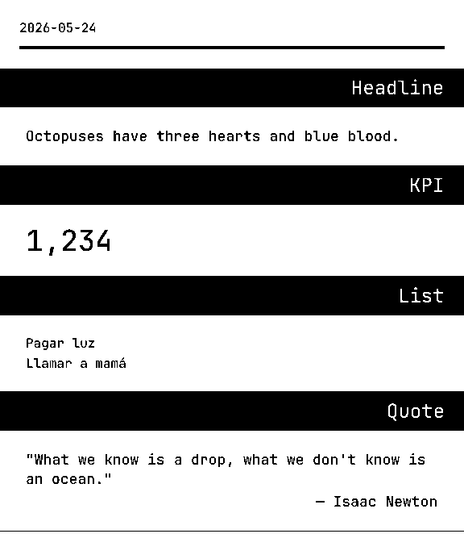
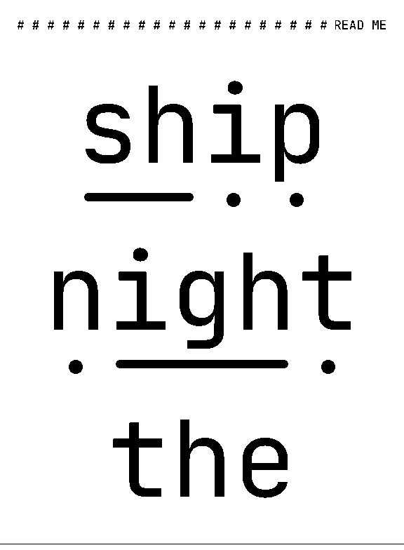
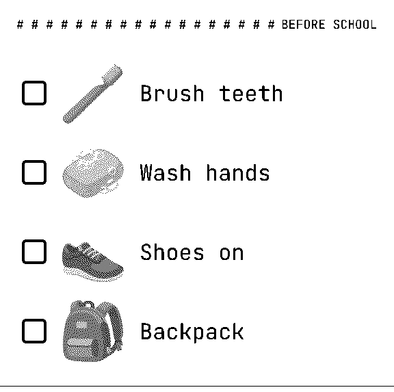
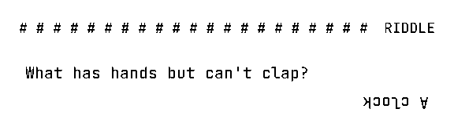
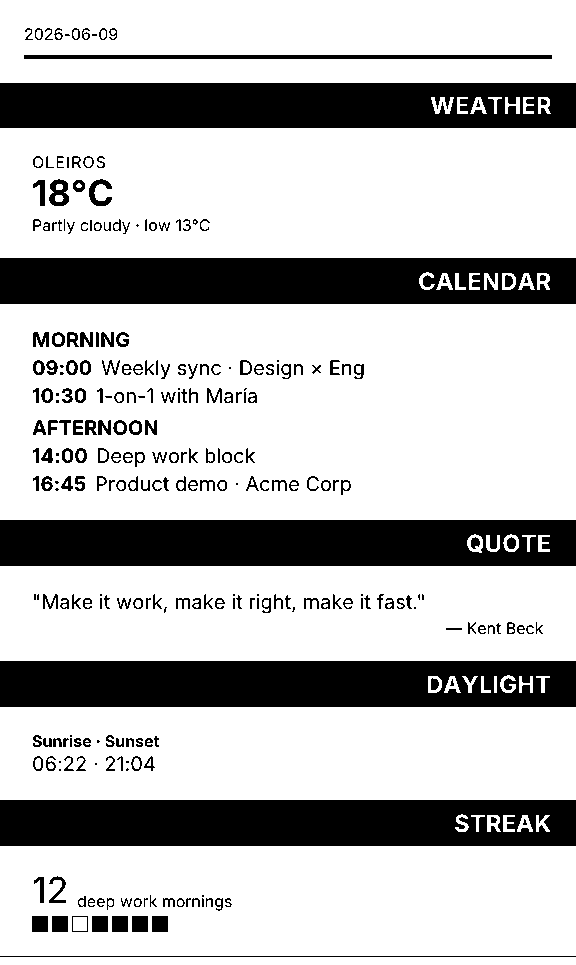
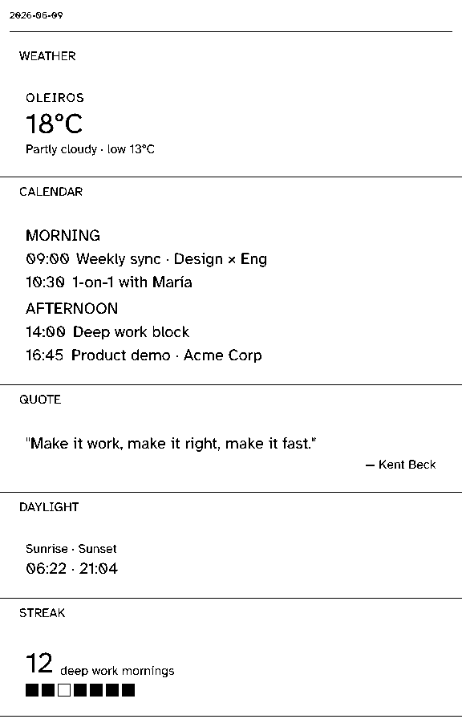
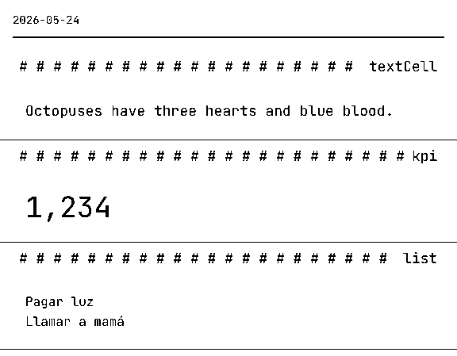

# pressedslip

> Compose printable slips from pre-built content blocks and send them directly to your thermal printer.

[](https://www.npmjs.com/package/pressedslip)
[](https://github.com/diegomarino/pressedslip/actions/workflows/ci.yml)
[](https://opensource.org/licenses/MIT)



<video src="https://github.com/user-attachments/assets/9df1895b-349f-410e-99cd-5cff7bf11700" controls autoplay loop muted width="100%"></video>

`pressedslip` lets you describe printable content as data, render it through
React/Satori/resvg, inspect the resulting composition, and then save the PNG or
send it to a transport. It is built for product dashboards, personal automation,
briefing printers, embedded displays, and any workflow where receipt-like output
should be generated from typed blocks instead of hand-built layout code.

[Try the playground](https://diegomarino.github.io/pressedslip/) |
[Read the docs](https://github.com/diegomarino/pressedslip/tree/main/docs) |
[API overview](https://github.com/diegomarino/pressedslip/blob/main/docs/api/README.md)

## Install

```bash
# pick one
pnpm add pressedslip
# or
npm install pressedslip
```

`satori` pins `fflate@0.7.3`, which `npm audit` flags (`unzipSync` infinite
loop; satori only calls `inflateSync`). A dependency of pressedslip cannot
change that pin for you, so add an override in your own `package.json`:

```json
{
  "overrides": { "fflate": "^0.7.5" },
  "pnpm": { "overrides": { "fflate@>=0.7.0 <0.7.5": "^0.7.5" } }
}
```

Use `overrides` for npm and Bun and `pnpm.overrides` (or `overrides` in
`pnpm-workspace.yaml`) for pnpm.

satori shapes text with `harfbuzzjs`, which loads `hb.wasm` from its own
package directory. If you bundle a Node server (esbuild, Rollup) to ESM, keep
`harfbuzzjs` external like `@resvg/resvg-js`; bundled, it fails at import with
`ReferenceError: __dirname is not defined`. Browser bundles need the alias in
[Browser rendering](https://github.com/diegomarino/pressedslip/blob/main/docs/guide/browser-rendering.md).

## Quick Example

```ts
import {
  render,
  createRegistry,
  builtinBlocks,
  loadThemeFonts,
  themes,
  PAPER,
  type CompositionInput,
} from "pressedslip";
import { writeFile } from "node:fs/promises";

const registry = createRegistry(builtinBlocks);
const theme = await loadThemeFonts(themes.default);

const composition: CompositionInput = {
  id: "morning-brief",
  version: 1,
  date: new Date().toISOString().slice(0, 10),
  status: "ready",
  slots: [
    {
      index: 0,
      blockType: "kpi",
      title: "WEATHER",
      data: { value: "18°C", label: "OLEIROS", caption: "Partly cloudy · low 13°C" },
    },
    {
      index: 1,
      blockType: "list",
      title: "CALENDAR",
      data: {
        groups: [
          {
            title: "MORNING",
            items: [
              { id: "09:00", value: "Weekly sync · Design × Eng" },
              { id: "10:30", value: "1-on-1 with María" },
            ],
          },
          {
            title: "AFTERNOON",
            items: [
              { id: "14:00", value: "Deep work block" },
              { id: "16:45", value: "Product demo · Acme Corp" },
            ],
          },
        ],
      },
    },
    {
      index: 2,
      blockType: "quotation",
      title: "QUOTE",
      data: {
        text: "Make it work, make it right, make it fast.",
        attribution: "Kent Beck",
      },
    },
    {
      index: 3,
      blockType: "keyValue",
      title: "DAYLIGHT",
      data: { label: "Sunrise · Sunset", value: "06:22 · 21:04" },
    },
  ],
};

const { bytes } = await render(composition, {
  registry,
  theme,
  width: PAPER.thermal80,
});

await writeFile("morning-brief.png", bytes);
```

## From data to paper

Each slot is plain data. Builtin blocks cover the everyday cases. A theme
override or a small [custom block](https://github.com/diegomarino/pressedslip/blob/main/docs/guide/custom-block-walkthrough.md)
covers the rest. These three are from the
[recipes](https://github.com/diegomarino/pressedslip/blob/main/docs/guide/recipes.md), and you can try them in the
[playground](https://diegomarino.github.io/pressedslip/).

<table>
<tr><th>Slot data</th><th>Printed</th></tr>
<tr>
<td>

**Phonics sound buttons** · custom block,
[`phonics-demo.tsx`](https://github.com/diegomarino/pressedslip/blob/main/apps/playground/src/showcase-blocks/phonics-demo.tsx)

```jsonc
{
  "blockType": "phonicsDemo",
  "title": "READ ME",
  "data": {
    "words": [
      { "word": "ship",  "graphemes": ["sh", "i", "p"] },
      { "word": "night", "graphemes": ["n", "igh", "t"] },
      { "word": "the",   "graphemes": ["the"], "tricky": true }
    ]
  }
}
```

The font fits the longest word to the paper, up to 160 px. A dot goes under
each letter and a dash under each digraph.

</td>
<td></td>
</tr>
<tr>
<td>

**Emoji checklist** · custom block reusing the builtin `image` block,
[`routine-demo.tsx`](https://github.com/diegomarino/pressedslip/blob/main/apps/playground/src/showcase-blocks/routine-demo.tsx)

```jsonc
{
  "blockType": "routineDemo",
  "title": "BEFORE SCHOOL",
  "data": {
    "items": [
      { "text": "Brush teeth", "image": { "src": "data:image/png;base64,…" } },
      { "text": "Wash hands",  "image": { "src": "data:image/png;base64,…" } },
      { "text": "Shoes on",    "image": { "src": "data:image/png;base64,…" } },
      { "text": "Backpack",    "image": { "src": "data:image/png;base64,…" } }
    ]
  }
}
```

Each emoji is rasterized to PNG so it gets dithered. Light colours survive
the 1-bit output ([why](https://github.com/diegomarino/pressedslip/blob/main/docs/guide/recipes.md#printing-emoji)).

</td>
<td></td>
</tr>
<tr>
<td>

**Upside-down riddle** · builtin `qaPair` with a theme override

```jsonc
{
  "blockType": "qaPair",
  "title": "RIDDLE",
  "data": {
    "question": "What has hands but can't clap?",
    "answer": "A clock"
  }
}
// theme: shell.textStyles.answer = { rotate: 180 }
```

No custom code: the reader flips the paper to read the answer.

</td>
<td></td>
</tr>
</table>

## Output format

`render()` produces a **1-bit PNG raster** at the printer's native 203 DPI. Width
is pixel-exact — 576 px for an 80mm roll is exactly 72mm of printable area at
that DPI. The `PAPER` constants handle the mm→px conversion and carry the
hardware margin metadata so you never need to calculate it manually:

| Preset | Roll width | Printable | Pixels | DPI |
|---|---|---|---|---|
| `PAPER.thermal58` | 58mm | ~48mm | 384 px | 203 |
| `PAPER.thermal80` | 80mm | ~72mm | 576 px | 203 |
| `PAPER.thermal110` | 110mm | ~104mm | 832 px | 203 |
| `PAPER.a4Portrait` | — | 210mm | ~1672 px | 203 |
| `PAPER.a4Landscape` | — | 297mm | ~2368 px | 203 |
| `PAPER.letterPortrait` | — | 215.9mm | ~1720 px | 203 |

**Sending to a printer:** `pressedslip/transports` ships an ESC/POS encoder
that converts the PNG into a printer-ready raster byte stream, plus a TCP
transport that opens a socket and sends it directly to any network-attached
thermal printer. No printer driver required.

```ts
import { createEscPosTransport } from "pressedslip/transports";

const transport = createEscPosTransport({ host: "192.168.1.50", port: 9100 });
await transport.send({ bytes });
```

## Why pressedslip?

- **Composable content blocks** - eight builtin blocks (text, list, key-value,
  KPI, Q&A, quotation, word-search, image); write your own via `defineBlock`.
- **Browser and Node renders from the same source** - `pressedslip/browser`
  ships a resvg-wasm path so the playground and Node CI render with identical
  output.
- **Interactive playground** - try real compositions before writing code:
  <https://diegomarino.github.io/pressedslip/>.
- **Pre-built themes** - three printable themes (default, compact, mono) with
  deterministic font and layout roles.
- **Provider lifecycle** - async data fetchers with parallel fetch, timeout,
  cache, and fail-soft. Plug in OpenMeteo, a static-text source, or your own.
- **Direct-to-printer delivery** - ESC/POS encoder converts the PNG to a raster
  byte stream; the TCP transport sends it straight to a network-attached printer.
  File and HTTP transports included for non-printer workflows (`pressedslip/transports`).

## Public API

`pressedslip` exposes a small set of package entrypoints:

| Import path | Runtime | Use it for |
|---|---|---|
| `pressedslip` | Node | Render PNGs, define blocks, build registries, compose provider-backed content, and load themes/fonts. |
| `pressedslip/browser` | Browser | Render through resvg-wasm and use browser-safe block, registry, theme, provider, and composition APIs. |
| `pressedslip/providers` | Node | File cache, node font cache, OpenMeteo provider, and provider registry helpers. |
| `pressedslip/transports` | Node | ESC/POS raster output, file transport, HTTP transport, and shared transport types. |
| `pressedslip/testing` | Tests | Builtin fixtures and structural assertion helpers for downstream regression tests. |

The human API overview lives in
[`docs/api/README.md`](https://github.com/diegomarino/pressedslip/blob/main/docs/api/README.md).
The complete symbol reference is generated from TSDoc:

```bash
pnpm docs:api
```

Generated TypeDoc HTML lands in `docs/api/reference/`. GitHub Pages is reserved
for the interactive playground, so the API reference is generated in CI and can
be built locally from the published source repo.

## Guides

- [Getting started](https://github.com/diegomarino/pressedslip/blob/main/docs/guide/getting-started.md)
- [Browser rendering](https://github.com/diegomarino/pressedslip/blob/main/docs/guide/browser-rendering.md)
- [Providers](https://github.com/diegomarino/pressedslip/blob/main/docs/guide/providers.md)
- [Custom blocks](https://github.com/diegomarino/pressedslip/blob/main/docs/guide/custom-block-walkthrough.md)
- [Recipes](https://github.com/diegomarino/pressedslip/blob/main/docs/guide/recipes.md): emoji, large type, upside-down answers, i18n
- [Themes](https://github.com/diegomarino/pressedslip/blob/main/docs/guide/themes.md)
- [Testing](https://github.com/diegomarino/pressedslip/blob/main/docs/guide/testing.md)
- [Transports](https://github.com/diegomarino/pressedslip/blob/main/docs/guide/transports.md)

See the [image block reference](https://github.com/diegomarino/pressedslip/blob/main/docs/blocks/image.md)
for local PNG/SVG inputs, sizing, and dithering.

## Visual Reference

The source repo ships rendered references for builtin blocks and themes:

| Default | Compact | Mono |
|---|---|---|
|  |  |  |

## Reliability Notes

PNG output is deterministic enough for product workflows, but it is not
byte-identical across every operating system, Node version, and Bun version.
Differences come from underlying font rasterizers (`resvg` and skia). Avoid raw
PNG snapshot assertions; use the structural assertion helpers in
`pressedslip/testing`.

Documentation and API health are checked in CI with `pnpm docs:api`,
`pnpm check-docs`, and `pnpm check-public-docs`.

## License

MIT - see [LICENSE](LICENSE).

**Font attribution:** the test fixtures bundle JetBrains Mono Regular,
licensed under [SIL Open Font License 1.1](https://scripts.sil.org/cms/scripts/page.php?item_id=OFL).

## Contributing

See
[CONTRIBUTING.md](https://github.com/diegomarino/pressedslip/blob/main/CONTRIBUTING.md).
