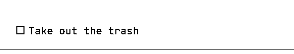
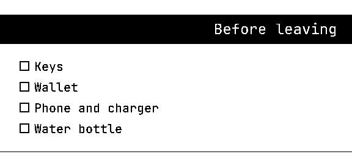
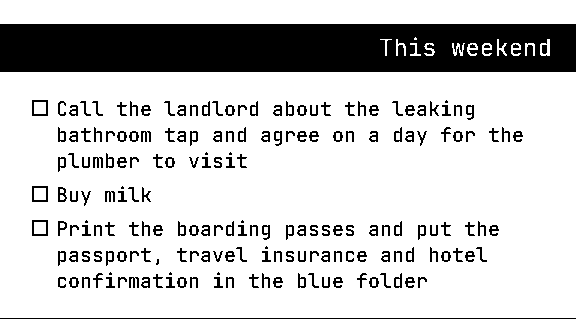

# checklist

## Purpose

Renders a list of items, each preceded by an empty checkbox, for paper
checklists people tick by hand (packing lists, groceries, chores). Items are
plain strings; the block has no checked state.

## Data schema

```ts
{
  items: string[];   // required — minimum 1 item (Zod .min(1)); one string per row
}
```

All fields validated by Zod. No `.default()` in the schema.

## Examples

```jsonc
// Minimal — a single item
{
  "blockType": "checklist",
  "data": { "items": ["Take out the trash"] }
}
```



```jsonc
// Typical — short packing list with a title
{
  "blockType": "checklist",
  "title": "Before leaving",
  "data": { "items": ["Keys", "Wallet", "Phone and charger", "Water bottle"] }
}
```



```jsonc
// Edge — long items wrap; the box stays level with the first line
{
  "blockType": "checklist",
  "title": "This weekend",
  "data": {
    "items": [
      "Call the landlord about the leaking bathroom tap and agree on a day for the plumber to visit",
      "Buy milk",
      "Print the boarding passes and put the passport, travel insurance and hotel confirmation in the blue folder"
    ]
  }
}
```



## Layout notes

The block renders a vertical flex column (8 px gap between items, 8 px outer
padding). Each item is a flex row: the checkbox, then the text. The row uses
the same wrap-safe layout as `list` (`width: 100%`, `alignItems: flex-start`;
box `flexShrink: 0` with `paddingRight` equal to the theme's `listItemGap`;
text `flexGrow: 1`, `flexBasis: 0`, `minWidth: 0`), so long items wrap inside
the 528 px effective content width and the box stays aligned with the first
line of text instead of the middle of a wrapped item. The `BlockShell` applies
`showTitle: true` and a `thin` (1 px) bottom separator by default.

The checkbox is never a Unicode ☐ glyph (font coverage is not guaranteed in
Satori). With `checkboxStyle: "box"` it is a `div` drawn with a border; with
`"text"` it is the theme's `checkboxGlyph` rendered in the body font.

Because items are plain strings, a checked state can be added later as
`string | { text, checked }` without breaking existing data.

## See also

- **list** — use for id/value rows, bullets or sectioned lists; use `checklist`
  when each line is something to tick off.

## Theme-controlled dimensions

| Field | Slot / token | Default |
|---|---|---|
| item text | `body` slot | `{ fontSize: 20 }` |
| box style | `checkboxStyle` (`"box"` or `"text"`) | `"box"` (`mono`: `"text"`) |
| text glyph | `checkboxGlyph` (only with `"text"`) | `"[ ]"` |
| box side | `checkboxSize` (px) | `16` (`compact`: `14`) |
| box border width | `checkboxBorderWidth` (px) | `2` |
| box corner radius | `checkboxRadius` (px) | `0` |
| box color | `checkboxColor` | resolved body text color, else `"#000"` |
| box ↔ text gap | `listItemGap` (shared with `list`) | `8` |

## Block-local intent

None. Every visual property of this block comes from the theme.
