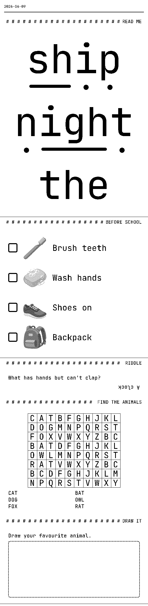
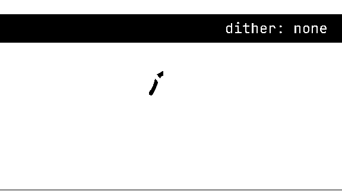
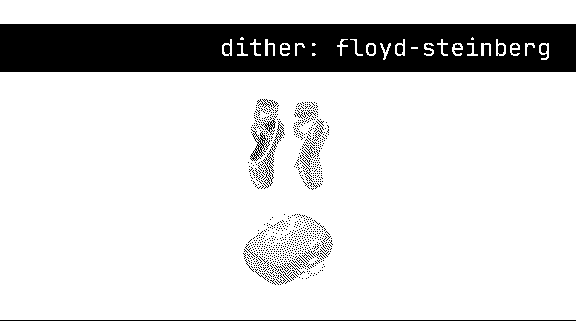
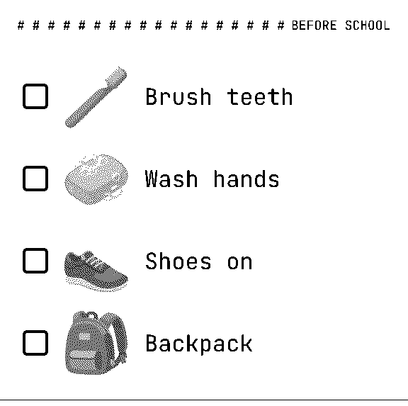
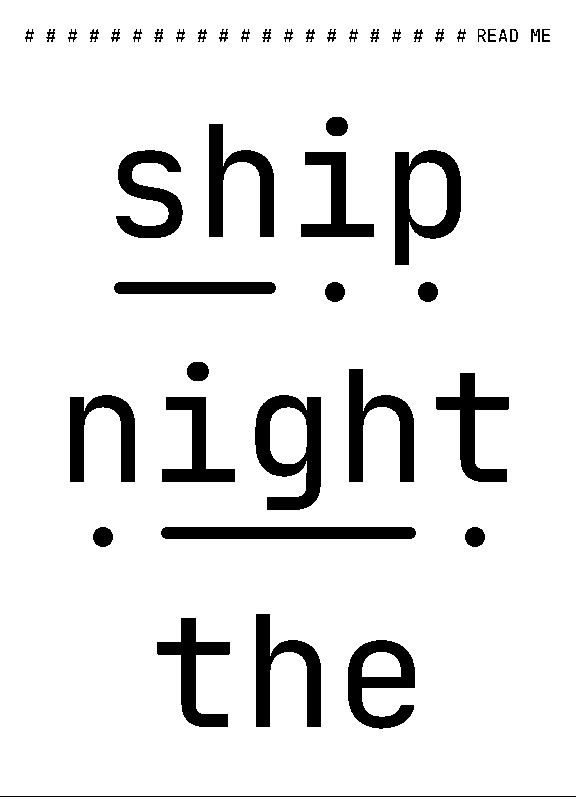
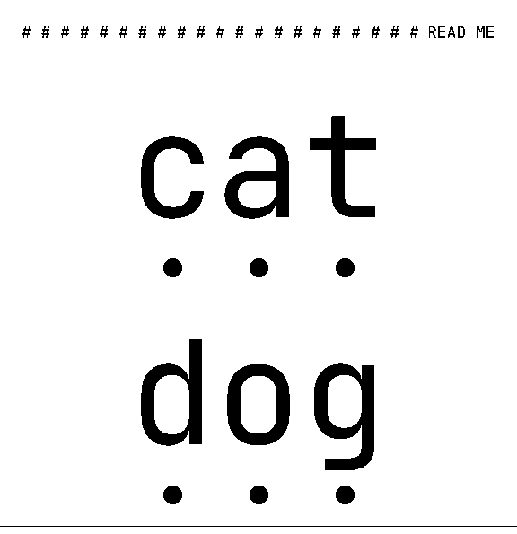
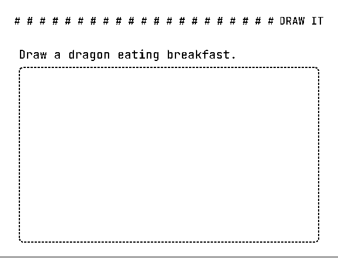

# Recipes

Short, copy-paste patterns for custom blocks, collected from real slips printed
on 80 mm thermal paper. Each one is also running code. The playground
showcase blocks live in
[`apps/playground/src/showcase-blocks/`](../../apps/playground/src/showcase-blocks/).
Open the [playground](https://diegomarino.github.io/pressedslip/) and pick
`phonics-demo`, `routine-demo`, `riddle-demo` or `drawing-prompt-demo` from
the palette, or choose a whole slip from the **Example** menu (Morning
briefing, Kids' morning, Puzzle time).

All images below are generated by `pnpm docs:visual-refs`.



- [Printing emoji](#printing-emoji)
- [Reusing a builtin inside your block](#reusing-a-builtin-inside-your-block)
- [Large type that fits the paper (phonics)](#large-type-that-fits-the-paper-phonics)
- [Upside-down answers](#upside-down-answers)
- [Wrapping a builtin to override theme values](#wrapping-a-builtin-to-override-theme-values)
- [Translating labels with `Composition.meta`](#translating-labels-with-compositionmeta)
- [Inline SVG icons](#inline-svg-icons)
- [Fonts without emoji or IPA glyphs](#fonts-without-emoji-or-ipa-glyphs)
- [Blank space on purpose](#blank-space-on-purpose)

## Printing emoji

Satori draws text with the fonts you load, and the builtin themes ship no emoji
glyphs, so `"🪥"` in a text node prints as nothing (or a tofu box). Print emoji
as **images** instead.

You can't just pass the emoji's SVG artwork straight through. The whole slip is
thresholded to 1 bit at the end, and emoji sets use flat, light colours. At a
plain threshold most of the artwork goes white. Rasterize the SVG to a **PNG**
first, on a white background. The [image block](../blocks/image.md) then
Floyd–Steinberg-dithers it, and light fills become stippled grey instead of
disappearing:

| Plain threshold (`dither: "none"`) | Dithered PNG (the default) |
|---|---|
|  |  |

In Node, `@resvg/resvg-js` does the rasterizing. The SVG files come from any
emoji set whose licence fits your use; the playground vendors a few
[Noto Emoji](https://github.com/googlefonts/noto-emoji) (Apache-2.0):

<!-- check-doc-snippets: skip -->
```ts
import { readFileSync } from "node:fs";
import { Resvg } from "@resvg/resvg-js";
import { imageFromBuffer } from "pressedslip";

/** Noto file name: lowercase hex codepoints joined by "_", without VS16 (U+FE0F). */
function notoFilename(emoji: string): string {
  const hex = [...emoji]
    .map((c) => c.codePointAt(0) ?? 0)
    .filter((cp) => cp !== 0xfe0f)
    .map((cp) => cp.toString(16));
  return `emoji_u${hex.join("_")}.svg`;
}

/** A PNG data URI of the emoji, `sizePx` wide, ready for the image block. */
export function emojiPng(emoji: string, sizePx: number): string {
  const svg = readFileSync(`./noto/svg/${notoFilename(emoji)}`);
  const png = new Resvg(svg, {
    fitTo: { mode: "width", value: sizePx },
    background: "#ffffff", // transparent pixels would threshold unpredictably
  })
    .render()
    .asPng();
  return imageFromBuffer(png, "image/png");
}
```

Rasterize at (or above) the printed size and cache the result per
`emoji + size`. In the browser, rasterize ahead of time, or with
`@resvg/resvg-wasm`. The playground ships pre-rendered data URIs, generated by
[`scripts/docs/generate-emoji-assets.mjs`](../../scripts/docs/generate-emoji-assets.mjs).

## Reusing a builtin inside your block

A builtin's `render` is a plain function. Calling it from your own block gives
you its rendering logic, for example the image block's PNG resampling and
dithering. The `routineDemo` block puts one emoji per checklist
row this way:



```tsx
import { defineBlock, imageBlock } from "pressedslip";
import { z } from "zod";

export const routineBlock = defineBlock({
  type: "routine",
  schema: z.object({
    items: z.array(z.object({ text: z.string(), icon: z.string() })).min(1),
  }),
  render: ({ data, ctx }) => (
    <div style={{ width: "100%", display: "flex", flexDirection: "column" }}>
      {data.items.map((item) => (
        <div key={item.text} style={{ display: "flex", alignItems: "center", gap: 12 }}>
          <div style={{ width: 36, height: 36, border: "4px solid #000", borderRadius: 6 }} />
          <div style={{ display: "flex", width: 112, height: 112 }}>
            {imageBlock.render({
              data: {
                layout: "column",
                fit: "none",
                dither: "floyd-steinberg",
                maxHeight: 96,
                images: [{ src: item.icon, alt: item.text }],
              },
              ctx,
            })}
          </div>
          <div style={{ display: "flex", fontSize: 32 }}>{item.text}</div>
        </div>
      ))}
    </div>
  ),
});
```

Two things to keep in mind:

- Your schema is the one that runs. Pass the builtin fully resolved data,
  including fields that its schema would otherwise default, such as `fit` and
  `dither` above.
- The builtin sizes itself from `ctx.contentWidth`, which is the full slot
  width. To keep it small, cap it from the data (here `maxHeight`) and wrap it
  in a fixed-size box.

The image block lays images out in a column only, so put several images side
by side with one call per image.

## Large type that fits the paper (phonics)

Early readers need very large letters, and phonics adds "sound buttons" under
them: a dot under each single-letter grapheme, a dash under digraphs and
trigraphs such as `sh` and `igh`. Tricky words get no marks.

| `phonicsDemo` · digraphs | `phonicsDemo` · capped size |
|---|---|
|  |  |

The patterns:

1. **Fit from `ctx.contentWidth`.** It is the usable width inside the shell
   padding. Divide it by the widest word's width in em. For a monospaced face
   every glyph advances exactly `0.6 em` (JetBrains Mono, the `mono` theme),
   which makes the "fits, one more pixel would not" test exact. If the theme
   might be proportional, budget per character instead of using an average.
   Wide letters (`m`, `w`, `M`, `W`) approach `1 em`, and an average lets
   `WWWW` run off the paper.
2. **Cap it.** `160 px` is about 20 mm at 203 dpi. Without a cap, a three-letter
   word fills the whole slip.
3. **Draw marks as boxes, not glyphs.** A `div` with `backgroundColor` and a
   `borderRadius` of half its size prints crisply at 1 bit and needs no font
   coverage. Put each grapheme in its own flex column so Satori measures the
   real glyph width and the mark centres under it.

```ts
const MAX_PX = 160;

/** Upper-bound advance in em: exact for monospaced faces, safe for proportional ones. */
function advanceEm(char: string): number {
  const base = char.normalize("NFD")[0] ?? char;
  if (/[mwMW]/.test(base)) return 1;
  if (/[A-Z0-9]/.test(base)) return 0.8;
  if (/[a-z]/.test(base)) return 0.66;
  return 1;
}

function fitFontSize(words: string[], contentWidth: number): number {
  const widest = Math.max(1, ...words.map((w) => [...w].reduce((em, c) => em + advanceEm(c), 0)));
  return Math.max(1, Math.min(MAX_PX, Math.floor(contentWidth / widest)));
}
```

The full block is
[`phonics-demo.tsx`](../../apps/playground/src/showcase-blocks/phonics-demo.tsx).

## Upside-down answers

Riddles and quizzes print the answer upside down, so the reader has to flip
the paper. No custom block is needed: the builtin `qaPair` draws its answer
with the `answer` text style, and `rotate: 180` works in any text style:

```ts
import { themes } from "pressedslip";

const riddleTheme = {
  ...themes.mono,
  shell: {
    ...themes.mono.shell,
    textStyles: {
      ...themes.mono.shell.textStyles,
      answer: { ...themes.mono.shell.textStyles?.answer, rotate: 180 },
    },
  },
};
```

That is how the riddle in the slip at the top of this page is printed. In a custom
block, spread a style and override it locally:
`applyTextStyle({ ...ctx.theme.textStyles.answer, rotate: 180 }, ctx.fontRoles)`.
The playground's
[`riddle-demo.tsx`](../../apps/playground/src/showcase-blocks/riddle-demo.tsx)
does exactly that, so the answer flips under every theme.
Stick to `0` and `180`: other angles swap the bounding box in Satori. The
[`riddle` example](../../examples/riddle/) runs this end to end.

## Wrapping a builtin to override theme values

A block definition is a plain object, so you can spread a builtin and replace
`render` to hand it an adjusted `ctx`. This is useful when your theme is right
for everything except one block. A common case is a light `separatorColor` that
looks good on screen but disappears at the 1-bit threshold, taking the
word-search grid with it:

```ts
import { type BlockDefinition, type WordSearchData, wordSearchBlock } from "pressedslip";

export const inkWordSearchBlock: BlockDefinition<WordSearchData> = {
  ...wordSearchBlock,
  render: ({ data, ctx }) =>
    wordSearchBlock.render({
      data,
      ctx: { ...ctx, theme: { ...ctx.theme, wordSearchBorderColor: "#000" } },
    }),
};
```

Register `inkWordSearchBlock` instead of the builtin. It keeps the `"wordSearch"`
type, schema and hints. For this specific case you can also just set
`wordSearchBorderColor` in the theme. As a rule, anything you want printed must
have luminance below 128.

## Translating labels with `Composition.meta`

`Composition.meta` is passed through untouched to every block as
`ctx.composition.meta`. Put the reader's language there once, and let blocks
pick their own labels:

```ts
import type { RenderContext } from "pressedslip";

type Labels = { rain: string; today: string };

const LABELS: Record<"en" | "es", Labels> = {
  en: { rain: "Rain", today: "Today" },
  es: { rain: "Lluvia", today: "Hoy" },
};

export function labelsFromCtx(ctx: RenderContext): Labels {
  const language = ctx.composition.meta?.language;
  return language === "es" ? LABELS.es : LABELS.en;
}
```

`ctx.composition.date` is also there, for localized weekday letters or
"days until" counters.

## Inline SVG icons

Satori renders inline `<svg>` natively, so single-path icon sets (for example
[Weather Icons](https://github.com/erikflowers/weather-icons), OFL) can be
embedded as path strings. Two tips:

- Fill with pure black (`fill="black"`). Greys and gradients go through the
  same 1-bit threshold as everything else.
- Many icon sets don't centre their glyphs in the `viewBox`: clouds sit low,
  suns sit high. Next to a text column the offset shows. Measure each glyph's
  bounding box once and shift the `viewBox` by the difference:
  `viewBox={\`0 ${centerY - 15} 30 30\`}`. Cropping the `viewBox` also makes
  a glyph that fills only part of its box print larger.

The [`weather` example](../../examples/weather/) draws its icon this way.

## Fonts without emoji or IPA glyphs

Satori can't fall back to system fonts. Any character missing from your loaded
faces prints as nothing. Either load a face that covers it, or clean the text
before it reaches the block:

```ts
/** Strip emoji (and the VS16 selector) from text bound for a text-only font. */
const stripEmoji = (s: string): string =>
  s.replace(/\p{Extended_Pictographic}/gu, "").replace(/️/g, "").trim();

/** Rough IPA → ASCII respelling for fonts without IPA glyphs. */
const IPA: Record<string, string> = { ʃ: "sh", θ: "th", ð: "th", ŋ: "ng", ə: "uh", ɪ: "i" };
const asciiPronunciation = (ipa: string): string =>
  [...ipa].map((c) => IPA[c] ?? c).join("");
```

For emoji you want *printed*, see [Printing emoji](#printing-emoji).

## Blank space on purpose

Paper is part of the design. A dashed frame to draw in, lines to write on, or a
cut-here margin is just an empty box with a solid-ink border:



```tsx
<div style={{ width: "100%", height: 300, border: "2px dashed #000", borderRadius: 8 }} />
```

The frame needs no font and nothing to dither, so it prints with no surprises.
